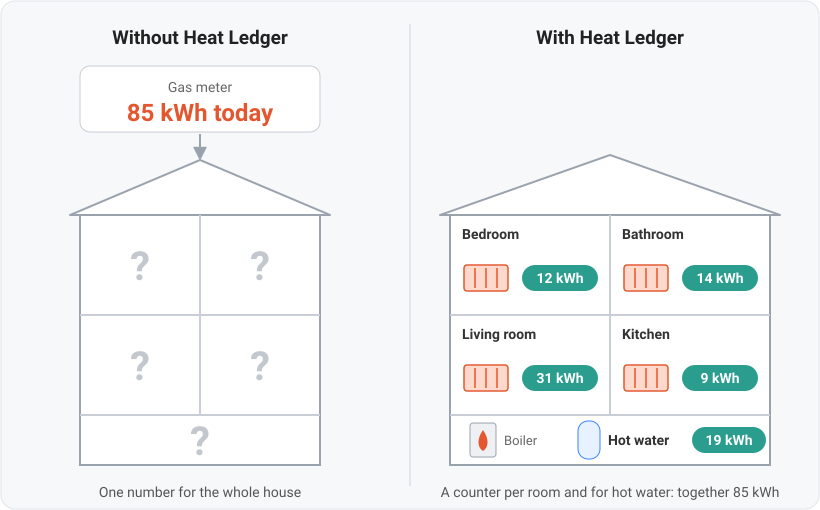

# Heat Ledger

A Home Assistant integration that shows where the heat of your heating goes: it splits the heat of your boiler, heat
pump or other heat source between your rooms and your hot water, as a counter per room for the Energy dashboard.

It estimates from what Home Assistant already knows (your heating's meter, your thermostats, optionally your pumps)
and gets more accurate with every detail you add. It only reads; it does not control anything.

**Status:** beta.

## Install

In the **Marketplace** of Home Assistant, choose **Add from link**, enter `https://github.com/benep/heat_ledger` as
type *Integration* and install Heat Ledger. Restart Home Assistant and add the integration.

## Help

Step by step, in English and German: **[benep.github.io/heat_ledger](https://benep.github.io/heat_ledger/)**

For developers: [architecture](docs/architecture.md), [development](docs/development.md).
