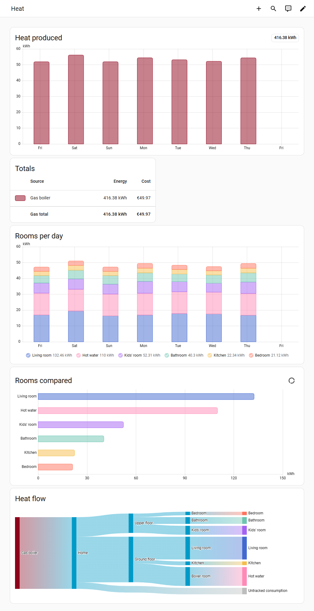

# Energie-Dashboard

Die Zähler von Heat Ledger gehören in den Reiter **Gas** des Energie-Dashboards. Dort zeigt Home Assistant sie als
einzelne Geräte: welcher Raum wie viel Wärme verbraucht hat, pro Tag, Woche oder Monat.

!!! info "Home Assistant 2026.12 oder neuer"

    Einzelne Geräte im Gas-Reiter gibt es seit Home Assistant 2026.12. Der Reiter heißt *Gas*, auch wenn deine Wärme
    von Öl, Holz oder einer Wärmepumpe kommt; das spielt keine Rolle.

## So sieht es aus

{ .screenshot }

Home Assistant gruppiert die Räume selbst nach **Stockwerk** und **Bereich**. Heat Ledger legt jede Raumheizung in
den Bereich ihres Thermostats; gib deinen Bereichen ein Stockwerk (**Einstellungen → Bereiche, Labels & Zonen**),
dann folgt die Gruppierung.

## Einrichten

Gehe zu **Einstellungen → Dashboards → Energie** und öffne den Reiter **Gas**.

!!! warning "Die Gas-Quelle muss in kWh zählen"

    Home Assistant lässt nur Gas-Quellen und einzelne Gasgeräte zusammen zu, die dieselbe Art von Einheit zählen:
    entweder alle Volumen (m³) oder alle Energie (kWh). Die Zähler der Räume zählen Wärme in kWh, also muss auch die
    **Gas-Quelle in kWh zählen**. Zählt dein Gaszähler in m³, nimm ihn hier nicht als Gas-Quelle, sondern den Sensor
    **Erzeugte Wärme** von Heat Ledger. Das ist dein Zähler mal dem Faktor, in kWh. Den Preis trägst du dann pro kWh
    ein.

{ .screenshot }

<div class="steps" markdown>

1. **Die Quelle.** Klicke unter **Gasverbrauch** auf **Gaszähler hinzufügen** und wähle deine Wärmequelle in kWh:
   den Zähler, den du Heat Ledger gegeben hast, wenn er Wärme in kWh zählt, sonst den Sensor **Erzeugte Wärme** von
   Heat Ledger. Einen Gaszähler in m³, der schon drinsteht, entferne (sein Verlauf bleibt). Einen Preis kannst du
   hier auch eintragen.
2. **Die Räume.** Klicke unter **Einzelne Gasgeräte** auf **Gerät hinzufügen** und wähle den Sensor **Wärme** einer
   Raumheizung. Wiederhole das für jeden Raum.
3. **Das Warmwasser.** Trage seinen Sensor **Wärme** genauso ein.

</div>

!!! tip "Anzeigename"

    Das Dashboard zeigt den Namen, den du im Feld **Anzeigename** einträgst. Ohne ihn zeigt es den Namen des Sensors,
    zum Beispiel *Wohnzimmer Wärme*.

**Nicht erfasst** ist, was deine Quelle über die Raumheizungen und das Warmwasser hinaus gezählt hat: die festen
Verluste, falls du welche eingetragen hast, und die Wärme aus der Zeit, bevor du Heat Ledger eingerichtet hast.

## Mit Heizkreis

Hast du Heat Ledger eine Heizkreispumpe gegeben, gibt es auch einen Zähler für den **Heizkreis**: alle seine Räume
zusammen.

- **Ein Heizkreis:** lass ihn weg. Trage die Räume direkt ein wie oben; das Dashboard gruppiert sie dann nach
  Stockwerk.
- **Mehrere Heizkreise** (Heizkörper und Fußbodenheizung, oder ein Kreis pro Stockwerk): trage jeden Heizkreis als
  Gerät ein und jeden seiner Räume mit dem Heizkreis als **vorgelagertes Gerät**. Die Räume stehen dann unter ihrem
  Heizkreis.

## Wärmepumpe oder Heizstab

Sie tauchen zweimal auf: im Strom-Reiter als Strom, im Gas-Reiter als Wärme. Doppelt gezählt wird nichts, die Reiter
werden nicht addiert. Setze den Preis der Wärmequelle im Gas-Reiter auf **0**, sonst stehen die Kosten doppelt in der
Übersicht.

## Ein Wärme-Dashboard

Der Strom-Reiter hat Diagramme pro Gerät, der Gas-Reiter noch nicht. Heat Ledger bringt zwei Karten mit, die sie für
die Gasgeräte zeigen. Damit baust du dir ein eigenes Dashboard für deine Wärme: alles aus dem Gas-Reiter, dazu deine
Räume im Verlauf und im Vergleich.

{ .screenshot }

Die Karten nehmen die Räume und das Warmwasser aus dem Gas-Reiter des Energie-Dashboards, du musst also nichts
ausfüllen: Trägst du dort einen Raum ein, erscheint er auch hier.

<div class="steps" markdown>

1. Gehe zu **Einstellungen → Dashboards**, klicke auf **Dashboard hinzufügen** und wähle **Neues Dashboard von Grund
   auf**.
2. Gib als **Titel** *Wärme* ein, wähle ein **Seitenleistensymbol** wie `mdi:radiator` und klicke auf
   **Erstellen**.
3. Öffne das neue Dashboard in der Seitenleiste. Klicke auf den Stift (**Dashboard bearbeiten**), dann auf die drei
   Punkte und **Raw-Konfigurationseditor**.
4. Ersetze alles dort durch den Text unten und klicke auf **Speichern**. Schließe den Editor und klicke auf
   **Fertig**.

</div>

```yaml
views:
  - title: Wärme
    type: sections
    max_columns: 3
    dense_section_placement: true
    footer:
      card:
        type: energy-date-selection
        opening_direction: right
        vertical_opening_direction: up
    sections:
      - type: grid
        column_span: 3
        cards:
          - type: energy-compare
            grid_options:
              columns: 36
          - type: energy-gas-graph
            title: Erzeugte Wärme
            grid_options:
              columns: 24
          - type: energy-sources-table
            title: Summen
            types:
              - gas
            grid_options:
              columns: 12
          - type: custom:heat-ledger-gas-devices-detail-graph
            title: Räume pro Tag
            grid_options:
              columns: 36
          - type: custom:heat-ledger-gas-devices-graph
            title: Räume im Vergleich
            grid_options:
              columns: 36
          - type: gas-sankey
            title: Wärmefluss
            group_by_floor: true
            group_by_area: true
            grid_options:
              columns: 36
```

Die Leiste unten wählt den Zeitraum, wie im Energie-Dashboard. Die beiden Karten kannst du auch auf jedes andere
Dashboard setzen: In der Kartenauswahl heißen sie *Heat Ledger: gas devices over time* und *Heat Ledger: gas devices
in total*.

## Heat Ledger entfernen

Löschst du Heat Ledger oder eine seiner Raumheizungen, verschwinden ihre Sensoren, ihr Verlauf bleibt. Das
Energie-Dashboard behält die Einträge und meldet sie als fehlend: entferne sie dort von Hand.
