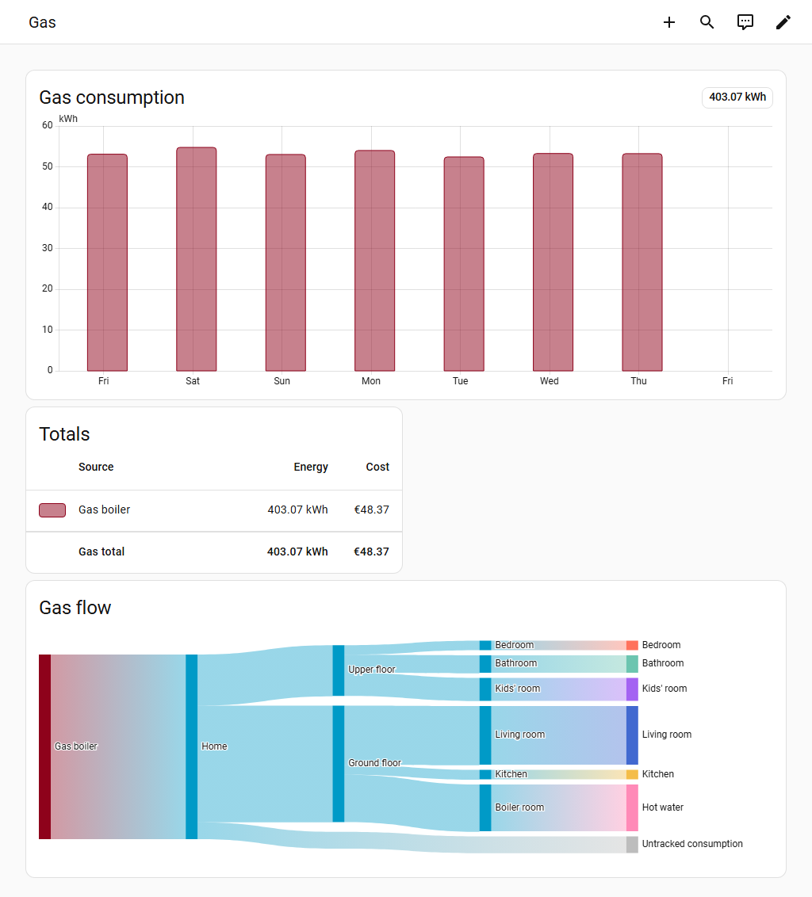
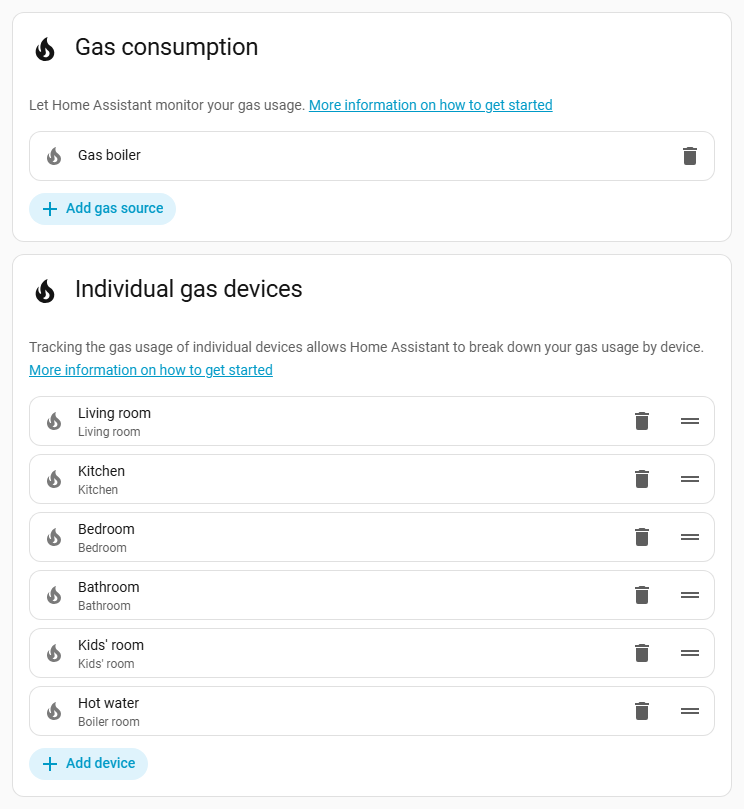

# Energy dashboard

The counters of Heat Ledger belong in the **gas** tab of the Energy dashboard. There, Home Assistant shows them as
individual devices: which room used how much heat, per day, week or month.

!!! info "Home Assistant 2026.12 or newer"

    Individual devices on the gas tab came with Home Assistant 2026.12. The tab is called *Gas* even if your heat
    comes from oil, wood or a heat pump; that does not matter.

## What it will look like

{ .screenshot }

Home Assistant groups the rooms by **floor** and **area** by itself. Heat Ledger puts every room heating into the area
of its thermostat; give your areas a floor (**Settings → Areas, labels & zones**), and the grouping follows.

## Set it up

Go to **Settings → Dashboards → Energy** and open the tab **Gas**.

!!! warning "The gas source must count in kWh"

    Home Assistant only lets you combine gas sources and individual gas devices that count the same kind of unit:
    either all volume (m³) or all energy (kWh). The room counters count heat in kWh, so the **gas source must count in
    kWh** as well. If your gas meter counts m³, do not use it as gas source here: use the sensor **Heat produced** of
    Heat Ledger instead. It is your meter times the factor, in kWh. Enter the price per kWh then.

{ .screenshot }

<div class="steps" markdown>

1. **The source.** Under **Gas consumption**, click **Add gas source** and choose your heat source in kWh: the
   meter you gave Heat Ledger if it counts heat in kWh, otherwise Heat Ledger's sensor **Heat produced**. Remove a
   gas meter in m³ that is already there (its history stays). You can enter a price here as well.
2. **The rooms.** Under **Individual gas devices**, click **Add device** and choose the **Heat** sensor of a room
   heating. Repeat for every room.
3. **The hot water.** Add its **Heat** sensor the same way.

</div>

!!! tip "Display name"

    The dashboard shows the name you enter in the **Display name** field. Without one, it shows the sensor's name,
    for example *Living room Heat*.

**Untracked** is what your source counted beyond the room heating and the hot water: the fixed losses, if you entered
any, and the heat from before you set up Heat Ledger.

## With a heating circuit

If you gave Heat Ledger a circuit pump, there is also a counter for the **heating circuit**: all its rooms together.

- **One circuit:** leave it out. Add the rooms directly as above; the dashboard then groups them by floor.
- **Several circuits** (radiators and underfloor heating, or one circuit per floor): add each circuit as a device,
  and each of its rooms with the circuit as **upstream device**. The rooms then sit below their circuit.

## A heat pump or an immersion heater

They show up twice: on the electricity tab as electricity, on the gas tab as heat. That is not counted twice, the
tabs are not added up. Set the price of the heat source on the gas tab to **0**, otherwise the costs appear twice in
the overview.

## Charts per room

The electricity tab has bar charts per device; the gas tab does not have them yet. Two **statistics graph** cards on
any dashboard give the same view. Replace the entities with your own **Heat** sensors. List the rooms and the hot
water, not the circuits, or the stacked bars count every room twice.

Heat per room and day, stacked:

```yaml
type: statistics-graph
title: Heat per day
chart_type: bar-stack
period: day
days_to_show: 7
stat_types:
  - change
entities:
  - entity: sensor.living_room_heat
    name: Living room
  - entity: sensor.bedroom_heat
    name: Bedroom
  - entity: sensor.bathroom_heat
    name: Bathroom
  - entity: sensor.hot_water_heat
    name: Hot water
```

Rooms side by side, per month:

```yaml
type: statistics-graph
title: Rooms compared
chart_type: bar
period: month
days_to_show: 30
stat_types:
  - change
entities:
  - entity: sensor.living_room_heat
    name: Living room
  - entity: sensor.bedroom_heat
    name: Bedroom
  - entity: sensor.bathroom_heat
    name: Bathroom
  - entity: sensor.hot_water_heat
    name: Hot water
```

Change `period` and `days_to_show` for other ranges, for example `period: week` with `days_to_show: 90`.

## Removing Heat Ledger

When you delete Heat Ledger or one of its room heatings, its sensors disappear, but their history stays. The Energy
dashboard keeps the entries and reports them as missing: remove them there by hand.
