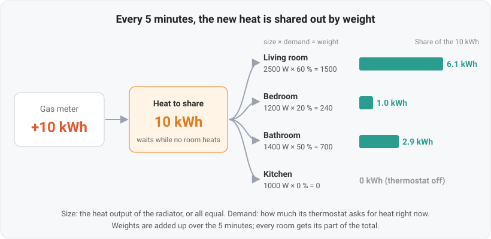
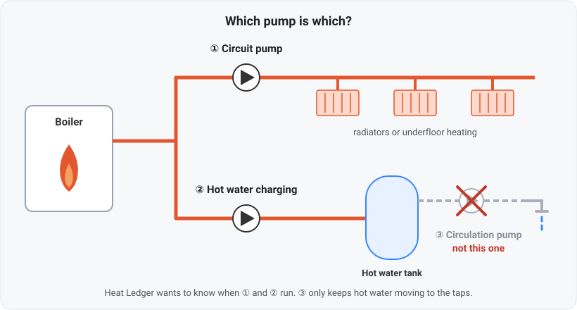
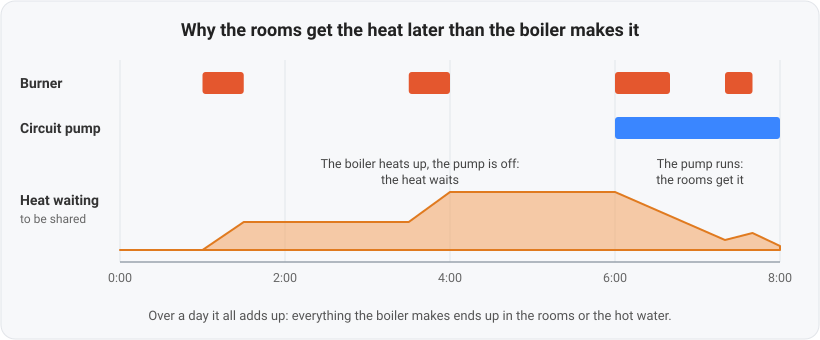
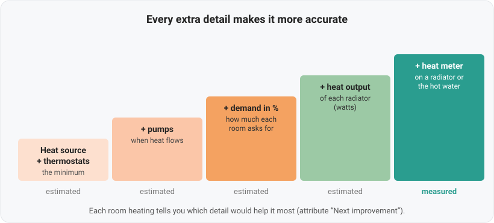

# So funktioniert es

Um Heat Ledger zu benutzen, musst du diese Seite nicht lesen. Sie hilft zu verstehen, warum die Zahlen so sind, wie
sie sind.

## Die Idee in einem Bild

Deine Heizung hat **einen Zähler** für das ganze Haus. Alle paar Minuten schaut Heat Ledger, wie viel neue Wärme er
gezählt hat, und verteilt sie auf die Räume, die in dieser Zeit geheizt haben.

{ .diagram }

Jeder Raum bekommt ein **Gewicht**: seine **Größe** mal seine **Anforderung**.

- **Größe** ist, wie viel Wärme sein Heizkörper abgeben kann, in Watt. Kennst du sie nicht, zählen alle Räume gleich
  (je 1000 W). Das ist schon ein brauchbarer Anfang.
- **Anforderung** ist, wie viel Wärme sein Thermostat gerade will: 0 % (zufrieden) bis 100 % (heizt mit voller
  Kraft). Ein Thermostat, das nur „heizt“ oder „heizt nicht“ meldet, zählt als 100 % oder 0 %.

Ein Raum mit großem Heizkörper, der ständig heizt, bekommt einen großen Anteil. Ein Raum mit ausgeschaltetem
Thermostat bekommt nichts.

## Die Pumpen: wann wirklich Wärme fließt

Ein Thermostat kann Wärme wollen, während gar keine fließt, zum Beispiel während der Kessel das Warmwasser heizt.
Deshalb will Heat Ledger auch wissen, wann die Pumpen laufen.

{ .diagram }

- ① **Heizkreispumpe**: läuft, solange warmes Wasser durch die Heizkörper oder die Fußbodenheizung fließt. Steht sie,
  bekommt kein Raum Wärme.
- ② **Warmwasser-Ladung**: läuft, solange der Kessel den Warmwasserspeicher heizt. Diese Wärme geht ans Warmwasser,
  nicht an die Räume. Eine Kombitherme ohne Speicher meldet stattdessen meist einen Status „Warmwasser“; das geht
  genauso.
- ③ Die **Zirkulationspumpe** hält nur das Warmwasser an den Zapfstellen warm. Sie spielt hier keine Rolle.

Beide Pumpen sind optional. Ohne sie verteilt Heat Ledger die Wärme immer dann, wenn ein Thermostat Wärme will.

## Warum die Räume die Wärme später bekommen

Dein Kessel heizt nicht immer genau dann, wenn die Räume die Wärme abnehmen. Nachts heizt er vielleicht sein Wasser
auf, während die Pumpen stehen. Heat Ledger legt diese Wärme so lange beiseite, bis ein Raum oder das Warmwasser sie
abnimmt.

{ .diagram }

Die wartende Wärme siehst du im Sensor **Nicht verteilte Wärme** deiner Heizungsanlage. Über den Tag geht alles auf:
Was dein Kessel erzeugt hat, landet in einem Raum oder im Warmwasser.

## Wie genau ist das?

Die **Summe** ist genau das, was dein Zähler gezählt hat. Wie gut sie **auf die Räume aufgeteilt** ist, hängt davon
ab, was Heat Ledger weiß:

{ .diagram }

Der Sensor jedes Raums zeigt, wie er gerechnet wird: Das Attribut **Stufe** sagt *geschätzt* oder *gemessen*, und
**Nächste Verbesserung** sagt, welche Angabe diesem Raum am meisten helfen würde. Was die einzelnen Angaben bringen,
steht unter [Genauer machen](more-accurate.md).

!!! tip "Was du erwarten kannst"

    - **Pro Tag und pro Woche** ist die Aufteilung gut: welche Räume viel verbrauchen, welche wenig.
    - **Pro Stunde** ist sie gröber, weil die Wärme manchmal wartet (siehe oben).
    - Zählt dein Zähler Brennstoff (Gas, Öl) statt Wärme, stecken die Verluste des Kessels in der Wärme der Räume. Die
      Anteile der Räume untereinander stimmen trotzdem.
