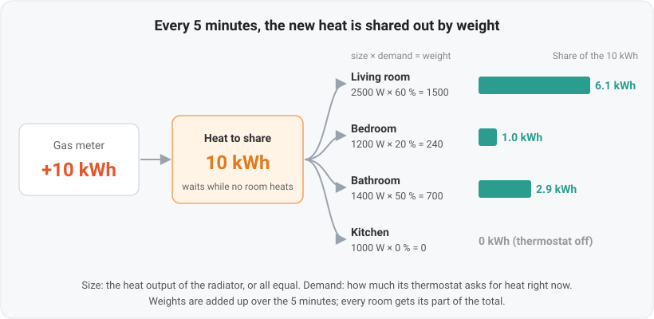
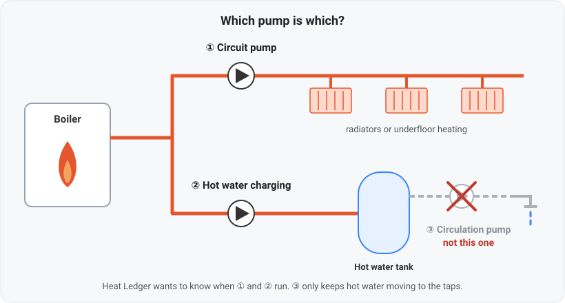
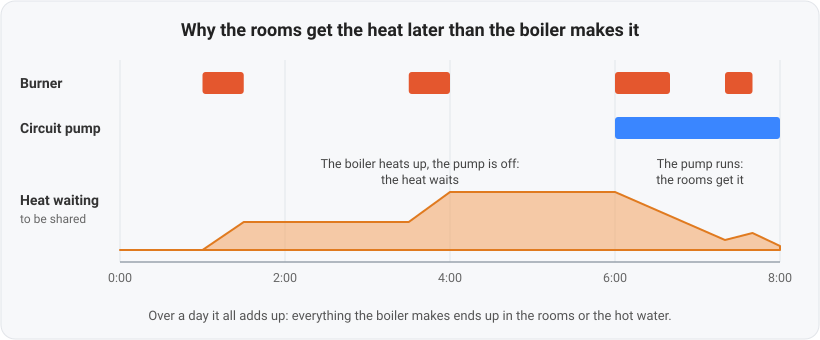
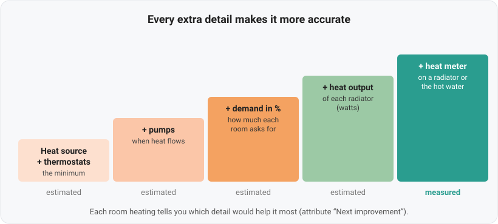

# How it works

You do not need to read this page to use Heat Ledger. It helps to understand why the numbers are what they are.

## The idea in one picture

Your heating has **one meter** for the whole house. Every few minutes, Heat Ledger looks at how much new heat it
counted and shares it out between the rooms that were heating at that time.

{ .diagram }

Each room gets a **weight**: its **size** times its **demand**.

- **Size** is how much heat its radiator can give off, in watts. If you do not know it, all rooms count as equal
  (1000 W each). That is already a useful start.
- **Demand** is how much its thermostat asks for heat right now: 0 % (satisfied) to 100 % (heating at full
  power). A thermostat that only says "heating" or "idle" counts as 100 % or 0 %.

A room with a big radiator that heats all the time gets a big share. A room whose thermostat is off gets nothing.

## The pumps: when heat really flows

A thermostat can ask for heat while no heat flows at all, for example while the boiler heats the hot water. So
Heat Ledger also wants to know when the pumps run.

{ .diagram }

- ① **Circuit pump**: runs while hot water goes through the radiators or the underfloor heating. While it stands
  still, no room gets heat.
- ② **Hot water charging**: runs while the boiler heats the hot water tank. That heat goes to "hot water", not to
  the rooms. A combi boiler without a tank usually reports a "hot water" status instead; that works the same.
- ③ The **circulation pump** only keeps hot water moving to the taps. It does not matter here.

Both pumps are optional. Without them, Heat Ledger shares out the heat whenever a thermostat asks for it.

## Why the rooms get the heat later

Your boiler does not always heat at the same time as the rooms take the heat. At night it may warm up its water
while the pumps stand still. Heat Ledger keeps that heat aside until a room or the hot water takes it.

{ .diagram }

You can see the heat that is waiting in the sensor **Unassigned heat** of your heating system. Over a day it all
adds up: everything your boiler made ends up in a room or in the hot water.

## How accurate is it?

The **total** is exactly what your meter counted. How well it is **split between the rooms** depends on what Heat
Ledger knows:

{ .diagram }

Each room's sensor shows how it is calculated: the attribute **Level** says *estimated* or *measured*, and **Next
improvement** says which detail would help that room most. [More accurate](more-accurate.md) explains each of them.

!!! tip "What to expect"

    - **Per day and per week** the split is good: which rooms use a lot, which use little.
    - **Per hour** it is rougher, because the heat sometimes waits (see above).
    - If your meter counts fuel (gas, oil) instead of heat, the losses of the boiler are part of the rooms' heat. The
      shares between the rooms stay right.
