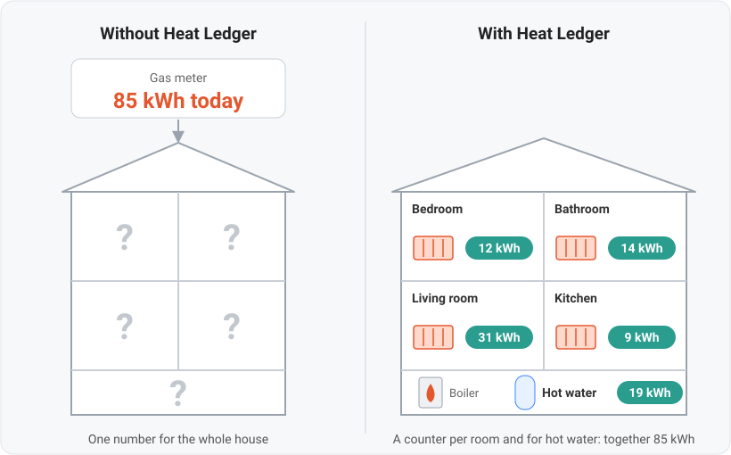
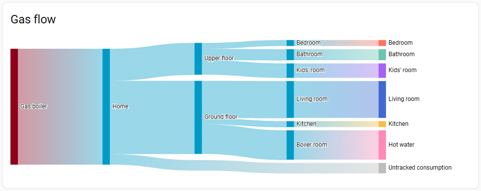

# Heat Ledger

**Wo bleibt die Wärme deiner Heizung?** Dein Gaszähler, dein Ölverbrauch oder deine Wärmepumpe sagt Home Assistant,
wie viel Wärme das ganze Haus verbraucht hat. Heat Ledger teilt diese Wärme auf deine Räume und dein Warmwasser auf,
damit du sie pro Raum siehst, direkt im Energie-Dashboard.

{ .diagram }

## Was du bekommst

- **Einen Zähler pro Raum** in kWh, für jeden Heizkörper oder jede Fußbodenheizung mit Thermostat.
- **Einen Zähler fürs Warmwasser**, wenn deine Heizung auch einen Warmwasserspeicher heizt.
- **Ein Bild im Energie-Dashboard**: welcher Raum wie viel verbraucht hat, pro Tag, Woche oder Monat.

{ .screenshot }

## Was du brauchst

- :material-home-assistant: **Home Assistant 2026.10 oder neuer**

    Als Geräte im Energie-Dashboard erscheinen die Räume ab **2026.12**. Davor zeigt sie ein
    [Wärme-Dashboard](energy-dashboard.md#ein-warme-dashboard).

- :material-counter: **Einen Zähler deiner Heizung**

    Irgendetwas in Home Assistant, das zählt, was deine Heizung verbraucht oder erzeugt, und nur steigt: ein
    Gaszähler, der Ölverbrauch, ein Wärmemengenzähler oder die Wärme, die eine Wärmepumpe meldet.

- :material-thermostat: **Thermostate in Home Assistant**

    Eines pro Raum oder Heizkörper, zum Beispiel von Tado, Netatmo, Homematic oder Zigbee-Heizkörperthermostate.

Optional, aber es macht die Aufteilung deutlich besser: ein Sensor, der meldet, wann die **Heizungspumpe** läuft, und
einer, der meldet, wann das **Warmwasser** geheizt wird. Wie du die bekommst, steht unter
[Einrichtung](setup.md#schritt-3-pumpen).

## Passt das zu dir?

Zwei Dinge entscheiden, ob Heat Ledger bei dir brauchbare Zahlen liefert. Beide prüfst du in einer Minute, bevor du
etwas installierst.

**Hat deine Heizung einen eigenen Zähler in Home Assistant?** Heat Ledger verteilt nur, was dieser Zähler zählt.

- :material-check: **Passt:** ein Haus oder eine Wohnung mit eigener Heizung (Gastherme, Ölkessel, Wärmepumpe,
  Fernwärme mit Wärmemengenzähler), deren Verbrauch oder Wärme in Home Assistant ankommt.
- :material-close: **Passt nicht:** eine Wohnung an einer Zentralheizung für das ganze Haus, von der du nur die
  jährliche Abrechnung kennst. Ohne Zähler gibt es nichts zu verteilen.
- Noch kein Zähler in Home Assistant? Wege dorthin stehen unter [Häufige Fragen](faq.md#erste-schritte).

**Melden deine Thermostate, ob sie gerade heizen?** Öffne **Einstellungen → Werkzeuge → Zustände** (in älteren
Versionen **Entwicklerwerkzeuge → Zustände**) und suche eines deiner Thermostate (`climate.…`). Steht bei seinen
Attributen `hvac_action` mit einem Wert wie `heating` oder `idle`, passt es.

- Fehlt `hvac_action`, sieh nach, ob das Thermostat einen eigenen Sensor in % hat (Heizleistung, Heizbedarf oder
  Ventilstellung). Den wählst du dann statt des Thermostats, siehe [Genauer machen](more-accurate.md#anforderung-in).
- Hat es keines von beiden, zählt der Raum als heizend, solange es kälter ist, als das Thermostat eingestellt ist
  (`current_temperature` unter `temperature`). Das ist gröber, weil ein Thermostat oft etwas vorher und nachher heizt,
  zeigt aber trotzdem, welche Räume viel heizen.
- Meldet das Thermostat auch die Raumtemperatur nicht, zählt der Raum als heizend, solange das Thermostat
  eingeschaltet ist. Die Wärme wird dann fast nur nach der Größe der Heizkörper verteilt: Dafür lohnt sich Heat Ledger
  kaum.

!!! info "Eine Schätzung, keine Messung"

    Heat Ledger misst die Wärme der einzelnen Räume nicht: An deinen Heizkörpern sitzt ja kein Zähler. Es schätzt die
    Aufteilung aus dem, was Home Assistant schon weiß: wie viel Wärme deine Heizung erzeugt hat und wann welches
    Thermostat geheizt hat. Die Summe stimmt immer; die Aufteilung auf die Räume ist eine gute Schätzung und wird mit
    jeder Angabe besser. Wie, zeigt [So funktioniert es](how-it-works.md).

!!! success "Gefahrlos ausprobieren"

    Heat Ledger liest nur. Es schaltet nichts, ändert keine Einstellung deiner Heizung oder deines Energie-Dashboards
    und geht nicht ins Internet.

## Nächste Schritte

1. Heat Ledger aus dem Marketplace von Home Assistant [**installieren**](installation.md) (5 Minuten).
2. [**Einrichten**](setup.md): vier kurze Schritte, in der Richtung, in der die Wärme fließt.
3. [**Die Räume ins Energie-Dashboard eintragen**](energy-dashboard.md).
