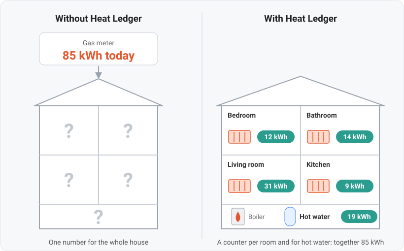
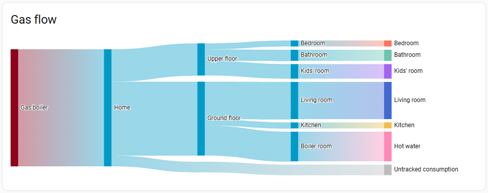

# Heat Ledger

**Where does the heat of your heating go?** Your gas meter, your oil consumption or your heat pump tells Home
Assistant how much heat the whole house used. Heat Ledger splits that heat between your rooms and your hot water,
so you can see it per room, right in the Energy dashboard.

{ .diagram }

## What you get

- **A counter per room**, in kWh, for every radiator or underfloor heating with a thermostat.
- **A counter for hot water**, if your boiler also heats a hot water tank.
- **A picture in the Energy dashboard**: which room used how much, per day, week or month.

{ .screenshot }

## What you need

- :material-home-assistant: **Home Assistant 2026.10 or newer**

    The rooms appear as devices in the Energy dashboard from **2026.12** on.

- :material-counter: **A meter for your heating**

    Anything in Home Assistant that counts what your heating uses or makes, and only goes up: a gas meter, the oil
    consumption, a heat meter or the heat a heat pump reports.

- :material-thermostat: **Thermostats in Home Assistant**

    One per room or radiator, for example from Tado, Netatmo, Homematic or Zigbee radiator valves.

Optional, but it makes the split much better: a sensor that tells when the **heating pump** runs, and one that
tells when the **hot water** is heated. [Setup](setup.md#step-3-pumps) explains how to get them.

!!! info "An estimate, not a measurement"

    Heat Ledger does not measure the heat of each room: there is no meter on your radiators. It estimates the split
    from what Home Assistant already knows: how much heat your heating made, and when each thermostat asked for it.
    The total is always right; the split between the rooms is a good estimate, and gets better with every detail
    you add. [How it works](how-it-works.md) shows how.

!!! success "Safe to try"

    Heat Ledger only reads. It does not switch anything, does not change any setting of your heating or your Energy
    dashboard, and does not go online.

## Next steps

1. [**Install**](installation.md) Heat Ledger from the Marketplace of Home Assistant (5 minutes).
2. [**Set it up**](setup.md): four short steps, in the direction the heat flows.
3. [**Add the rooms to the Energy dashboard**](energy-dashboard.md).
