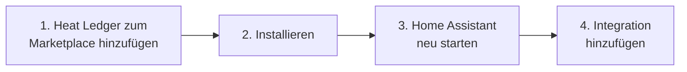

# Installation

Heat Ledger wird über den **Marketplace** installiert, der in Home Assistant eingebaut ist: Du findest ihn in der
Seitenleiste.

## 1. Heat Ledger zum Marketplace hinzufügen

Heat Ledger steht noch nicht im Katalog des Marketplace. Du fügst es deshalb einmal über seinen GitHub-Link hinzu.
Klicke auf diesen Knopf:

[Heat Ledger zum Marketplace hinzufügen](https://my.home-assistant.io/redirect/marketplace_repository/?owner=benep&repository=heat_ledger&category=integration){ .md-button .md-button--primary }

Oder von Hand:

1. Öffne **Marketplace** in der Seitenleiste und wähle den Reiter **Über Link hinzufügen**.
2. Trage `https://github.com/benep/heat_ledger` als **GitHub-Link** ein und wähle **Integration** als **Typ**.
3. Klicke auf **Hinzufügen**.

!!! info "Hinzufügen über einen Link braucht ein GitHub-Konto"

    Beim ersten Mal fragt Home Assistant, ob du **GitHub verbinden** willst (ein kostenloses Konto genügt). Es zeigt
    dir einen Code; öffne den angezeigten Link, melde dich bei GitHub an und gib den Code dort ein. Dein
    GitHub-Passwort gibst du nie in Home Assistant ein, und die Verbindung liest nur öffentliche Informationen. Sobald
    Heat Ledger im Katalog des Marketplace steht, fällt dieser Schritt weg.

## 2. Installieren

Öffne **Heat Ledger** im Marketplace, klicke auf **Installieren** und bestätige.

## 3. Home Assistant neu starten

Eine neue Integration findet Home Assistant erst nach einem Neustart. Der Marketplace zeigt dafür direkt nach der
Installation einen Knopf **Home Assistant neu starten**.

## 4. Integration hinzufügen

Klicke auf diesen Knopf, oder gehe zu **Einstellungen → Geräte & Dienste → Integration hinzufügen** und suche nach
**Heat Ledger**:

Die Einrichtung startet sofort. Weiter geht es mit der [Einrichtung](setup.md).

??? question "Updates"

    Eine neue Version von Heat Ledger zeigt der Marketplace wie jedes andere Update unter **Einstellungen → Updates**
    an. Deine Zähler behalten ihren Stand über Updates und Neustarts hinweg.
