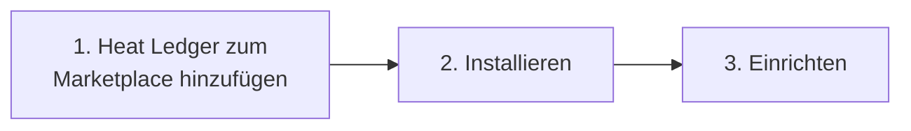

# Installation

Heat Ledger wird über den **Marketplace** installiert, der in Home Assistant eingebaut ist: Du findest ihn in der
Seitenleiste.

## 1. Heat Ledger zum Marketplace hinzufügen

Heat Ledger steht noch nicht im Katalog des Marketplace. Du fügst es deshalb einmal über seinen GitHub-Link hinzu.
Klicke auf diesen Knopf:

Bestätige die Frage **Benutzerdefiniertes Repository hinzufügen**. Danach bist du direkt auf der Seite von Heat Ledger
im Marketplace.

Oder von Hand:

1. Öffne **Marketplace** in der Seitenleiste und wähle den Reiter **Über Link hinzufügen**.
2. Trage `https://github.com/benep/heat_ledger` als **GitHub-Link** ein und wähle **Integration** als **Typ**.
3. Klicke auf **Hinzufügen**.

!!! info "Hinzufügen über einen Link braucht ein GitHub-Konto"

    Beim ersten Mal fragt Home Assistant, ob du **GitHub verbinden** willst (ein kostenloses Konto genügt). Es zeigt
    dir einen Code; öffne den angezeigten Link, melde dich bei GitHub an und gib den Code dort ein. Dein
    GitHub-Passwort gibst du nie in Home Assistant ein, und die Verbindung liest nur öffentliche Informationen. Bist du
    über den Knopf gekommen, klicke ihn danach noch einmal. Sobald Heat Ledger im Katalog des Marketplace steht, fällt
    dieser Schritt weg.

## 2. Installieren

Klicke auf der Seite von Heat Ledger auf **Installieren** und bestätige.

Hast du Heat Ledger von Hand hinzugefügt, steht es weder unter **Entdecken** noch in der Suche. Du findest es über das
Menü **⋮** oben rechts unter **Benutzerdefinierte Repositorys**.

## 3. Einrichten

Die Einrichtung startet direkt nach der Installation von selbst, ein Neustart ist nicht nötig. Weiter geht es mit der
[Einrichtung](setup.md).

Hast du sie geschlossen oder willst später ein weiteres Gebäude einrichten, füge die
[Integration noch einmal hinzu](https://my.home-assistant.io/redirect/config_flow_start/?domain=heat_ledger): unter
**Einstellungen → Geräte & Dienste → Integration hinzufügen** mit der Suche nach **Heat Ledger**.

??? question "Updates"

    Eine neue Version von Heat Ledger zeigt der Marketplace wie jedes andere Update unter **Einstellungen → Updates**
    an. Ein Update braucht einen Neustart von Home Assistant; der Marketplace fordert ihn an. Deine Zähler behalten
    ihren Stand über Updates und Neustarts hinweg.
