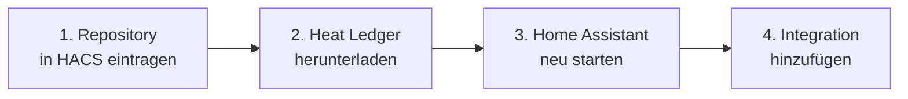

# Installation

Heat Ledger wird mit **HACS** installiert, dem Community-Store für Home Assistant. Hast du HACS noch nicht, installiere
es zuerst: [hacs.xyz](https://hacs.xyz/docs/use/).

## 1. Repository in HACS eintragen

Heat Ledger steht noch nicht in der Liste von HACS. Du sagst HACS deshalb einmal, wo es zu finden ist:

1. Öffne **HACS** in der Seitenleiste.
2. Klicke oben rechts auf die drei Punkte :material-dots-vertical: und wähle **Benutzerdefinierte Repositories**.
3. Trage `https://github.com/benep/heat_ledger` als **Repository** ein und wähle **Integration** als **Typ**.
4. Klicke auf **Hinzufügen** und schließe den Dialog.

## 2. Heat Ledger herunterladen

1. Suche in HACS nach **Heat Ledger** und öffne es.
2. Klicke unten rechts auf **Herunterladen** und bestätige.

## 3. Home Assistant neu starten

Eine neue Integration findet Home Assistant erst nach einem Neustart: **Einstellungen → System**, oben rechts der
Ein-/Aus-Knopf :material-power:, **Home Assistant neu starten**.

## 4. Integration hinzufügen

Klicke auf diesen Knopf, oder gehe zu **Einstellungen → Geräte & Dienste → Integration hinzufügen** und suche nach
**Heat Ledger**:

Die Einrichtung startet sofort. Weiter geht es mit der [Einrichtung](setup.md).

??? question "Updates"

    Eine neue Version von Heat Ledger zeigt HACS wie jedes andere Update unter **Einstellungen → Updates** an. Deine
    Zähler behalten ihren Stand über Updates und Neustarts hinweg.
