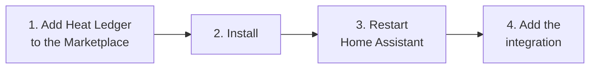

# Installation

Heat Ledger is installed from the **Marketplace**, which is built into Home Assistant: you find it in the sidebar.

## 1. Add Heat Ledger to the Marketplace

Heat Ledger is not in the catalog of the Marketplace yet, so you add it once by its GitHub link. Click this button:

[Add Heat Ledger to the Marketplace](https://my.home-assistant.io/redirect/marketplace_repository/?owner=benep&repository=heat_ledger&category=integration){ .md-button .md-button--primary }

Or by hand:

1. Open **Marketplace** in the sidebar and choose the tab **Add from link**.
2. Enter `https://github.com/benep/heat_ledger` as **GitHub link** and choose **Integration** as **Type**.
3. Click **Add**.

!!! info "Adding from a link needs a GitHub account"

    The first time you add something from a link, Home Assistant asks you to **connect GitHub** (a free account is
    enough). It shows a code; open the link it gives you, sign in to GitHub and enter the code there. You never enter
    your GitHub password in Home Assistant, and the connection only reads public information. Once Heat Ledger is in
    the catalog of the Marketplace, this step is no longer needed.

## 2. Install

Open **Heat Ledger** in the Marketplace, click **Install** and confirm.

## 3. Restart Home Assistant

Home Assistant only finds a new integration after a restart. The Marketplace shows a button **Restart Home
Assistant** right after the installation.

## 4. Add the integration

Click this button, or go to **Settings → Devices & services → Add integration** and search for **Heat Ledger**:

The setup starts right away. Continue with [Setup](setup.md).

??? question "Updates"

    The Marketplace shows a new version of Heat Ledger like any other update under **Settings → Updates**. Your
    counters keep their values across updates and restarts.
