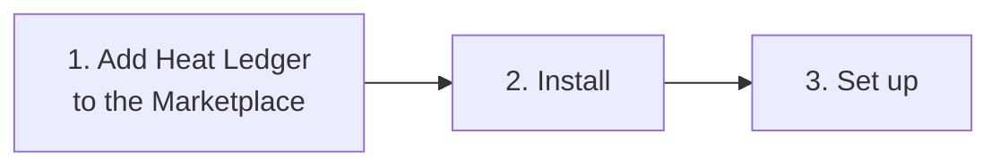

# Installation

Heat Ledger is installed from the **Marketplace**, which is built into Home Assistant: you find it in the sidebar.

## 1. Add Heat Ledger to the Marketplace

Heat Ledger is not in the catalog of the Marketplace yet, so you add it once by its GitHub link. Click this button:

Confirm the question **Add custom repository**. You are then right on the page of Heat Ledger in the Marketplace.

Or by hand:

1. Open **Marketplace** in the sidebar and choose the tab **Add from link**.
2. Enter `https://github.com/benep/heat_ledger` as **GitHub link** and choose **Integration** as **Type**.
3. Click **Add**.

!!! info "Adding from a link needs a GitHub account"

    The first time you add something from a link, Home Assistant asks you to **connect GitHub** (a free account is
    enough). It shows a code; open the link it gives you, sign in to GitHub and enter the code there. You never enter
    your GitHub password in Home Assistant, and the connection only reads public information. If you came by the
    button, click it once more afterwards. Once Heat Ledger is in the catalog of the Marketplace, this step is no
    longer needed.

## 2. Install

On the page of Heat Ledger, click **Install** and confirm.

If you added Heat Ledger by hand, it is neither under **Discover** nor in the search. You find it in the menu **⋮** at
the top right, under **Custom repositories**.

## 3. Set up

The setup starts by itself right after the installation, no restart needed. Continue with [Setup](setup.md).

If you closed it, or want to set up another building later,
[add the integration again](https://my.home-assistant.io/redirect/config_flow_start/?domain=heat_ledger): under
**Settings → Devices & services → Add integration**, search for **Heat Ledger**.

??? question "Updates"

    The Marketplace shows a new version of Heat Ledger like any other update under **Settings → Updates**. An update
    needs a restart of Home Assistant; the Marketplace asks for it. Your counters keep their values across updates and
    restarts.
