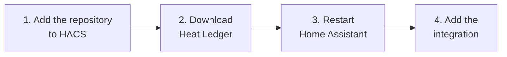

# Installation

Heat Ledger is installed with **HACS**, the community store for Home Assistant. If you do not have HACS yet, install
it first: [hacs.xyz](https://hacs.xyz/docs/use/).

## 1. Add the repository to HACS

Heat Ledger is not in the HACS list yet, so you tell HACS where to find it once:

1. Open **HACS** in the sidebar.
2. Click the three dots :material-dots-vertical: at the top right and choose **Custom repositories**.
3. Enter `https://github.com/benep/heat_ledger` as **Repository** and choose **Integration** as **Type**.
4. Click **Add** and close the dialog.

## 2. Download Heat Ledger

1. Search for **Heat Ledger** in HACS and open it.
2. Click **Download** at the bottom right and confirm.

## 3. Restart Home Assistant

Home Assistant only finds a new integration after a restart: **Settings → System**, the power button
:material-power: at the top right, **Restart Home Assistant**.

## 4. Add the integration

Click this button, or go to **Settings → Devices & services → Add integration** and search for **Heat Ledger**:

The setup starts right away. Continue with [Setup](setup.md).

??? question "Updates"

    HACS shows a new version of Heat Ledger like any other update under **Settings → Updates**. Your counters keep
    their values across updates and restarts.
