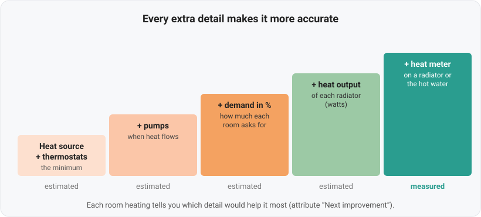
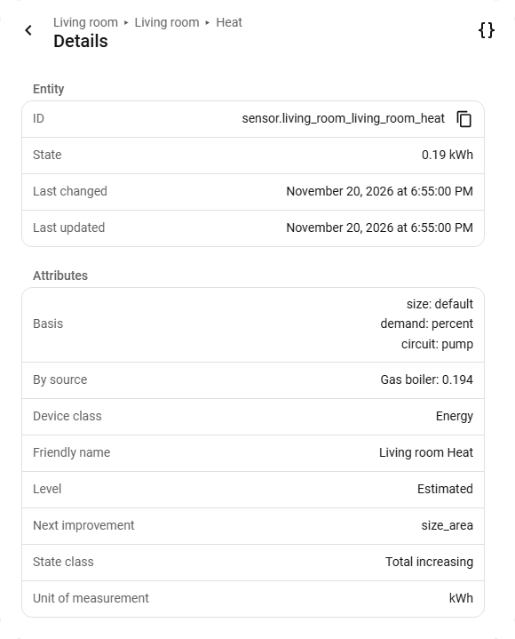

# Genauer machen

Schon mit dem Minimum, einer Wärmequelle und den Thermostaten, liefert die Einrichtung eine brauchbare Schätzung. Jede
weitere Angabe macht sie genauer. Keine davon ist nötig, und du kannst sie jederzeit ergänzen, ohne dass die Zähler
neu anfangen.

{ .diagram }

!!! tip "Welche Angabe hilft am meisten?"

    Öffne den Sensor **Wärme** einer Raumheizung und sieh dir seine Attribute an: **Nächste Verbesserung** nennt die
    Angabe, die diesem Raum am meisten helfen würde. **Stufe** sagt, ob er *geschätzt* oder *gemessen* ist.

    { .screenshot }

So änderst du eine Raumheizung: **Einstellungen → Geräte & Dienste → Heat Ledger**, das Zahnrad :material-cog: in
ihrer Zeile. Die Angaben stehen unten im Abschnitt **Genauer machen**.

## Pumpen: wann Wärme fließt

Der größte Schritt. Ohne Heizkreispumpe zählt ein Raum immer dann, wenn sein Thermostat Wärme will, auch während der
Kessel nur das Warmwasser heizt. Ohne Warmwasser-Ladung wird die Wärme fürs Warmwasser auf die Räume verteilt.

Die Heizkreispumpe trägst du mit **Heizkreis hinzufügen** ein, das Warmwasser mit **Verbraucher hinzufügen →
Warmwasser**. Danach wählst du in jeder Raumheizung den Heizkreis. Wie du aus einer Steckdose mit Leistungsmessung
einen Pumpen-Sensor machst, steht unter [Einrichtung](setup.md#schritt-3-pumpen).

Beim Schätzen der Zeit vor den aufgezeichneten Tagen gilt eine Pumpe als immer an, weil Home Assistant den Verlauf
von Binärsensoren nicht lange aufhebt. Wird die Leistung der Pumpe gemessen (der Leistungssensor der Steckdose), wähle
sie, bevor die Schätzung läuft, denn sie läuft nur einmal: bei der Einrichtung unter **Genauer machen** im Schritt
Pumpen, oder als **Leistung der Pumpe** im Heizkreis und im Warmwasser, bevor du sie mit der Aktion startest. Dann
weiß sie, wie lange jede Pumpe in jeder Stunde lief, ab der ersten Stunde, für die ihre Leistung Statistiken hat.

## Anforderung in %

Ein Thermostat, das nur *heizt* oder *heizt nicht* meldet, zählt als 100 % oder 0 %. Viele Thermostate melden mehr:
wie viel Wärme sie wollen, in %.

| Thermostat | Was du als **Thermostat oder Anforderung** wählst |
|---|---|
| Tado | Den Sensor *… Heizleistung* (Heizleistung in %). Heat Ledger bietet ihn von selbst an, wenn du das Thermostat wählst. |
| Netatmo, Homematic, viele Zigbee-Ventile | Die **Ventilstellung** in %, falls es eine gibt. Stelle dann **Anforderung in % ist** auf *Ventilstellung*. |
| Fußbodenheizung mit Stellantrieben | Den Stellantrieb (an/aus). |

## Größe: die Heizleistung jedes Heizkörpers

Ohne Größe zählen alle Raumheizungen gleich (je 1000 W). Ein großer Heizkörper im Wohnzimmer zählt dann so viel wie
ein kleiner im WC. Dafür gibt es zwei Felder, nimm **eines** davon:

| Feld | Wann |
|---|---|
| **Nennleistung** (W) | Die Heizleistung des Heizkörpers, vom Typenschild oder aus dem Datenblatt. Die Hersteller geben sie „bei 75/65/20 °C“ an. Die beste Wahl. |
| **Raumfläche** (m²) | Wenn du die Nennleistung nicht kennst. Zählt als 60 W pro m². |

Du kannst beides mischen: ein Raum mit Nennleistung, ein anderer mit Fläche. Lässt du beide Felder leer, zählt der
Raum als 1000 W.

!!! info "Heizkörper, die nur lauwarm werden"

    Die Nennleistung gilt für einen Heizkörper, der genug Wasser bekommt. In einer Anlage ohne hydraulischen Abgleich
    werden manche Heizkörper auch voll aufgedreht nur lauwarm: Trage bei ihnen eine kleinere Zahl ein. Warum, steht
    unter [Häufige Fragen](faq.md#die-zahlen).

??? question "Wo finde ich die Nennleistung?"

    - Auf einem **Typenschild** am Heizkörper, oft seitlich oder unten.
    - Im **Datenblatt** des Herstellers: Suche nach dem Typ (z. B. *22* für einen Flachheizkörper mit zwei Platten und
      zwei Lagen Lamellen) und der Größe (Höhe × Länge).
    - Viele Hersteller haben einen **Rechner** auf ihrer Website: Typ, Höhe und Länge eingeben, er zeigt die Leistung
      bei 75/65/20 °C.
    - Für eine **Fußbodenheizung** ohne Daten nimm die Fläche.

    Genau muss es nicht sein: Wichtig ist, dass ein großer Heizkörper eine größere Zahl bekommt als ein kleiner.

## Wärmemengenzähler

Hat ein Heizkörper, eine Fußbodenheizung oder das Warmwasser einen echten **Wärmemengenzähler** mit eigenem
Zählerstand in Home Assistant, wähle ihn unter **Wärmemengenzähler**. Heat Ledger nimmt dann die gemessene Wärme und
verteilt nur den Rest auf die anderen. Diese Raumheizung ist dann *gemessen*, Größe und Anforderung braucht sie nicht.

Die meisten Wohnungen haben keine Wärmemengenzähler an den Heizkörpern; genau dafür gibt es Heat Ledger.

## Weitere Wärmequellen

Ein wasserführender Kamin, ein Heizstab, ein zweiter Kessel: Trage jede Quelle mit **Wärmequelle hinzufügen** ein. Die
Wärme aller Quellen wird zusammengezählt und gemeinsam verteilt. Das Attribut **Nach Quelle** jedes Raums zeigt, wie
viel seiner Wärme aus welcher Quelle kam.

## Feste Verluste

Ein Warmwasserspeicher oder lange Leitungen verlieren ständig Wärme, egal ob ein Raum heizt oder nicht. Weißt du
ungefähr, wie viel, trage es in kW über das Zahnrad :material-cog: der Heizungsanlage ein (die oberste Zeile). Es wird vor der Aufteilung
abgezogen, und das Energie-Dashboard zeigt es als *nicht erfasst*. Weißt du es nicht, lass das Feld leer: Dann landen
die Verluste bei den Räumen.
