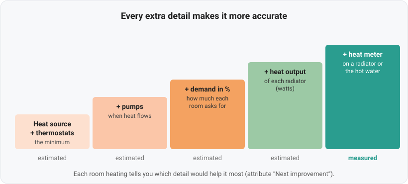
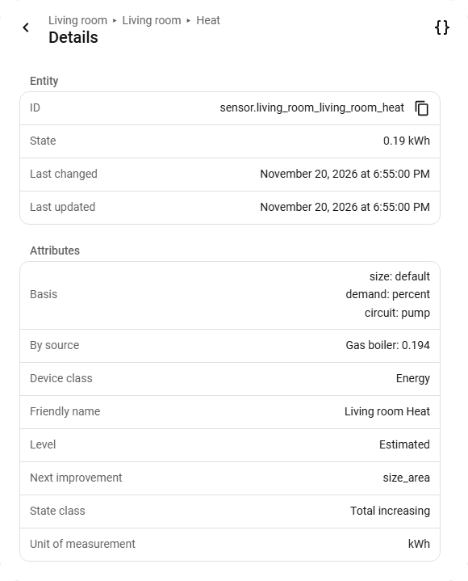

# More accurate

The setup gives a useful estimate with the minimum: a heat source and the thermostats. Every detail you add makes it
more accurate. None of them is needed, and you can add them at any time without the counters starting over.

{ .diagram }

!!! tip "Which detail helps most?"

    Open a room heating's **Heat** sensor and look at its attributes: **Next improvement** names the detail that would
    help that room most. **Level** says whether it is *estimated* or *measured*.

    { .screenshot }

To change a room heating: **Settings → Devices & services → Heat Ledger**, the gear icon :material-cog: in its row.
The details are in the section **More accurate** at the bottom.

## Pumps: when heat flows

The biggest step. Without the circuit pump, a room counts whenever its thermostat asks for heat, also while the boiler
only heats the hot water. Without the hot water charging, the heat for hot water is shared out between the rooms.

Add the circuit pump with **Add heating circuit**, the hot water with **Add consumer → Hot water**. Then choose the
circuit in each room heating. [Setup](setup.md#step-3-pumps) shows how to make a pump sensor from a smart plug.

For estimating the time before the recorded days, a pump counts as always running, because Home Assistant keeps no
long history of binary sensors. If the pump's power is measured (the smart plug's power sensor), choose it before the
estimate runs, as it runs only once: in the first setup under **More accurate** in the pumps step, or as **Pump power**
in the circuit and the hot water before you choose **Calculate the past** in the gear. It then knows how long each
pump ran in every hour, from the first hour its power has statistics.

## Demand in %

A thermostat that only says *heating* or *idle* counts as 100 % or 0 %. Many thermostats report more: how much they
ask for heat, in %.

| Thermostat | What to choose as **Thermostat or demand** |
|---|---|
| Tado | The sensor *… Heating* (heating power in %). Heat Ledger offers it by itself when you choose the thermostat. |
| Netatmo, Homematic, many Zigbee valves | The **valve position** in %, if there is one. Then set **Demand in % is** to *Valve position*. |
| Underfloor heating with actuators | The actuator (on/off). |

## Size: the heat output of each radiator

Without a size, all room heatings count as equal (1000 W each). A big radiator in the living room then counts as much
as a small one in the toilet. Two fields, use **one** of them:

| Field | When |
|---|---|
| **Nominal power** (W) | The heat output of the radiator, from its type plate or data sheet. The manufacturers give it "at 75/65/20 °C". The best choice. |
| **Floor area** (m²) | If you do not know the nominal power. Counts as 60 W per m². |

You can mix them: one room with nominal power, the other with floor area. Leave both empty and the room counts as
1000 W.

!!! info "Radiators that only get lukewarm"

    The nominal power holds for a radiator that gets enough water. In a system without hydraulic balancing, some
    radiators stay lukewarm even when fully open: enter a smaller number for them. [Questions](faq.md#the-numbers)
    explains why.

??? question "Where do I find the nominal power?"

    - On a **type plate** on the radiator, often at the side or bottom.
    - In the **data sheet** of the manufacturer: look for the type (e.g. *22* for a panel radiator with two panels and
      two rows of fins) and the size (height × length).
    - Many manufacturers have a **calculator** on their website: enter type, height and length, it shows the output
      at 75/65/20 °C.
    - For an **underfloor heating** without data, use the floor area.

    It does not have to be exact: what counts is that a big radiator gets a bigger number than a small one.

## Heat meter

If a radiator, an underfloor heating or the hot water has a real **heat meter** with its own reading in Home
Assistant, choose it under **Heat meter**. Heat Ledger then takes the measured heat and only shares out the rest between the others. That
room heating is then *measured*, and its size and demand are not needed.

Most homes do not have heat meters on their radiators; that is what Heat Ledger is for.

## More heat sources

A fireplace with a water jacket, an immersion heater, a second boiler: add each with **Add heat source**. The heat of
all sources is added up and shared out together. Each room's attribute **By source** shows how much of its heat came
from which source.

## Fixed losses

A hot water tank or long pipes lose heat all the time, whether a room heats or not. If you know about how much, enter
it in kW with the gear icon :material-cog: of the heating system (the topmost row). It is taken off before the split, and the Energy dashboard shows it
as *untracked*. Leave it empty if you do not know: the losses then go to the rooms.
