# Einrichtung

Die Einrichtung stellt vier kurze Fragen, in der Richtung, in der die Wärme fließt: von der Wärmequelle über die
Pumpen zu den Räumen. Alles lässt sich später ändern und ergänzen.

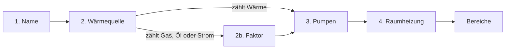

!!! tip "Es gibt keinen Zurück-Knopf"

    Ist etwas schiefgegangen, schließe den Dialog und fang neu an. Gespeichert wird erst im letzten Schritt.

## Schritt 1: Name

Der Name deiner Heizungsanlage, zum Beispiel *Heizung* oder *Haus*. Er ist nur eine Beschriftung.

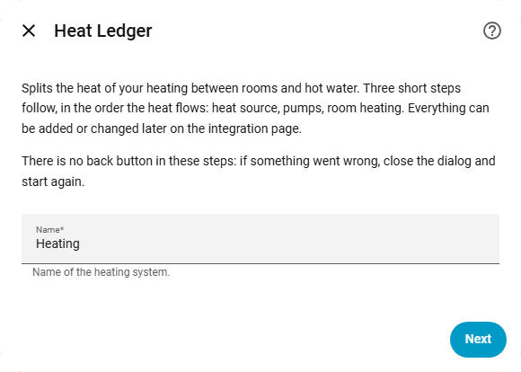{ .screenshot }

## Schritt 2: Wärmequelle

Woher kommt die Wärme? Wähle den **Zähler** deiner Heizung: eine Entität in Home Assistant, die zählt, was die Heizung
verbraucht oder erzeugt, und nur steigt.

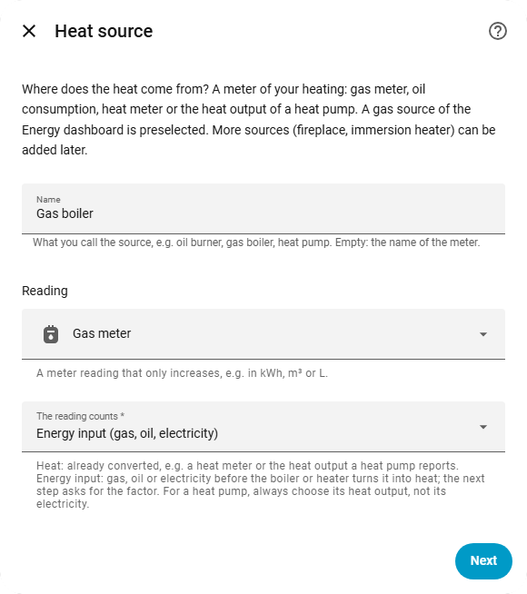{ .screenshot }

| Feld | Was du einträgst |
|---|---|
| **Name** | Wie du die Quelle nennst, z. B. *Gastherme*. Leer: der Name des Zählers. |
| **Zählerstand** | Der Zähler, z. B. dein Gaszähler in m³ oder kWh. Hast du schon eine Gas-Quelle im Energie-Dashboard, ist sie vorausgewählt. |
| **Der Zählerstand zählt** | **Wärme** oder **Energieeinsatz**, siehe unten. |

**Wärme oder Energieeinsatz?** Das ist die eine Frage, über die du kurz nachdenken musst:

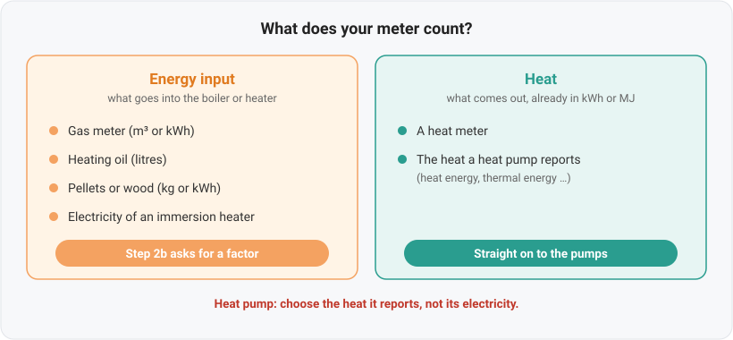{ .diagram }

!!! tip "Wärmepumpe"

    Die meisten Wärmepumpen melden die Wärme, die sie erzeugt haben, oft *Wärmemenge*, *thermische Energie* oder
    *erzeugte Wärme* genannt. Nimm diese, als **Wärme**. Ihr Strom wäre der falsche Zähler: Eine Wärmepumpe macht aus
    einer kWh Strom 3 bis 4 kWh Wärme, und dieses Verhältnis ändert sich mit dem Wetter.

### Schritt 2b: Faktor (nur bei Energieeinsatz)

Wie viele kWh Wärme ergibt eine Einheit deines Zählers? Typische Werte:

| Dein Zähler zählt | Faktor | Warum |
|---|---|---|
| Gas in m³ | etwa 9 bis 10 | Brennwert × Zustandszahl (beide auf der Gasrechnung) × Wirkungsgrad des Kessels |
| Heizöl in Litern | etwa 9 | Ein Liter enthält rund 10 kWh, der Kessel macht davon rund 90 % zu Wärme |
| Gas, Öl oder Pellets in kWh | etwa 0,9 | Der Wirkungsgrad des Kessels |
| Brennerlaufzeit in Stunden | die Leistung des Brenners in kW | Nur bei einem Brenner, der immer mit derselben Leistung läuft |
| Strom eines Heizstabs | 1 | Alles wird zu Wärme |

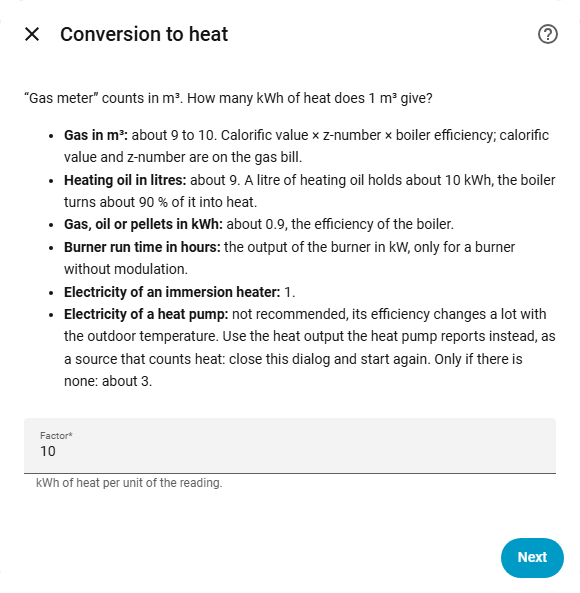{ .screenshot }

Ein Faktor, der etwas daneben liegt, schadet der Aufteilung nicht: Alle Räume steigen oder sinken gemeinsam, ihre
Anteile bleiben gleich.

## Schritt 3: Pumpen

Die Pumpen sagen Heat Ledger, **wann** Wärme in die Räume oder ins Warmwasser fließt. Beide Felder sind optional,
machen die Aufteilung aber deutlich genauer.

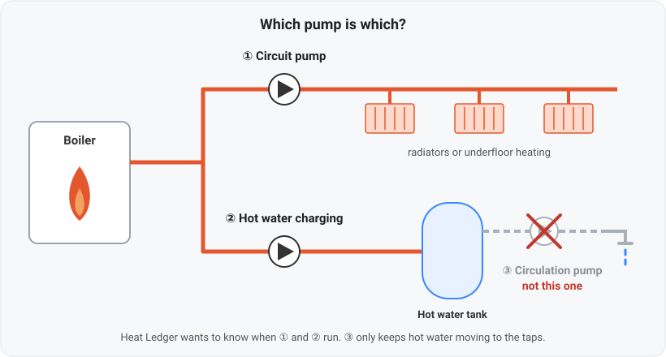{ .diagram }

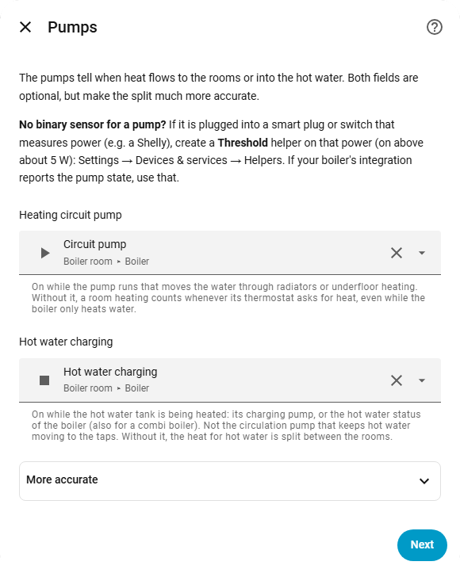{ .screenshot }

| Feld | Was du einträgst |
|---|---|
| **Heizkreispumpe** | Ein Binärsensor, der *an* ist, solange die Pumpe für die Heizkörper oder die Fußbodenheizung läuft. |
| **Warmwasser-Ladung** | Ein Binärsensor, der *an* ist, solange der Warmwasserspeicher geheizt wird: seine Ladepumpe oder der Warmwasser-Status deines Kessels (auch bei einer Kombitherme). Nicht die Zirkulationspumpe. |

### Kein Binärsensor für eine Pumpe?

Viele Kessel melden ihre Pumpen über ihre eigene Integration. Wenn deiner das nicht tut, die Pumpe aber an einer
Steckdose oder einem Schaltaktor mit Leistungsmessung hängt (zum Beispiel einem Shelly), baust du dir in einer Minute
einen:

1. Gehe zu **Einstellungen → Geräte & Dienste → Helfer → Helfer erstellen → Schwellenwert**.
2. Wähle die **Leistung** der Steckdose als Entität und trage **5** als **Obergrenze** ein (eine laufende Pumpe
   braucht mehr als 5 W, eine stehende fast nichts).
3. Gib ihm einen Namen wie *Heizkreispumpe* und speichere. Diesen neuen Binärsensor wählst du in Schritt 3.

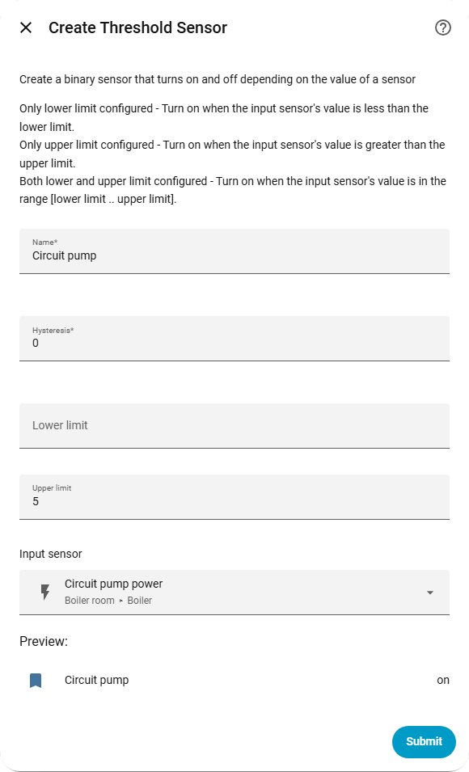{ .screenshot }

Die Pumpen kannst du auch später ergänzen: die Heizkreispumpe mit **Heizkreis hinzufügen**, das Warmwasser unter
**Verbraucher hinzufügen**.

## Schritt 4: Raumheizung

Wähle die **Thermostate** deiner Heizkörper oder Fußbodenheizung. Jedes wird eine *Raumheizung* mit eigenem Zähler.

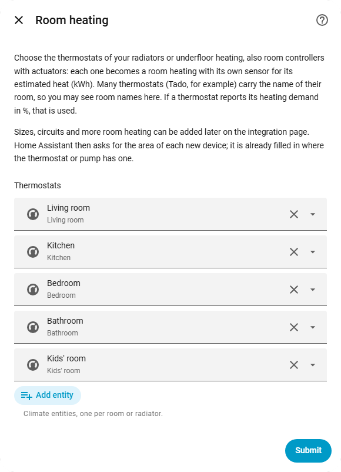{ .screenshot }

- Jede Raumheizung heißt wie ihr Thermostat. Viele Thermostate tragen den Namen ihres Raums, deshalb siehst du hier
  Raumnamen.
- Meldet ein Thermostat auch seinen Heizbedarf in % (zum Beispiel Tado), nimmt Heat Ledger den von selbst.
- Ein Raum mit zwei Heizkörpern und einem Thermostat zählt als eine Raumheizung.

Klicke auf **Absenden**. Home Assistant fragt danach nach dem **Bereich** jedes neuen Geräts. Wo das Thermostat oder
die Pumpe schon einen hat, ist er eingetragen: einfach **Fertig** klicken. Über die Bereiche gruppiert das
Energie-Dashboard die Räume nach Stockwerk.

## Was du jetzt hast

Öffne **Einstellungen → Geräte & Dienste → Heat Ledger**. Dort siehst du deine Heizungsanlage mit ihren Teilen:

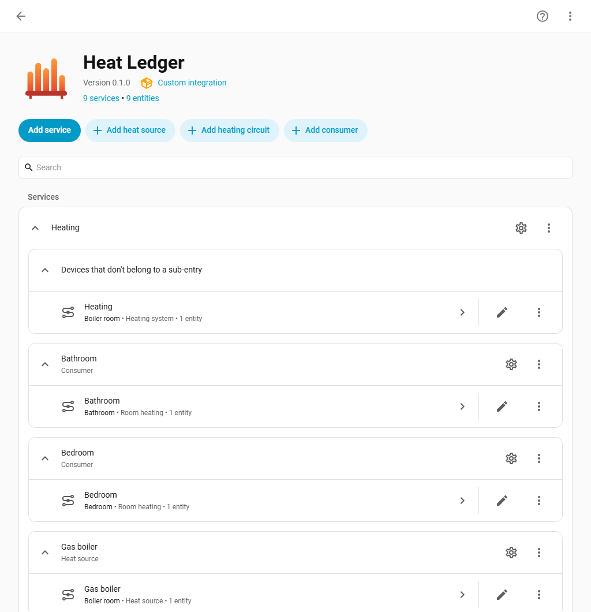{ .screenshot }

| Teil | Was es ist |
|---|---|
| **Heizungsanlage** | Das Ganze. Ihr Sensor **Nicht verteilte Wärme** zeigt Wärme, die noch auf die Verteilung wartet. |
| **Wärmequelle** | Dein Zähler. Zählt er Energieeinsatz, bekommt er einen Sensor **Erzeugte Wärme** (Zählerstand mal Faktor). |
| **Heizkreis** | Nur wenn du eine Heizkreispumpe gewählt hast: die Heizkörper dahinter, mit einem Zähler für alle zusammen. |
| **Raumheizung** | Eine pro Thermostat, mit dem Zähler **Wärme** in kWh. |
| **Warmwasser** | Nur wenn du die Warmwasser-Ladung gewählt hast, mit dem Zähler **Wärme** in kWh. |

Die Zähler beginnen bei 0 und wachsen ab jetzt.

## Läuft es?

Heat Ledger rechnet alle fünf Minuten. So siehst du, ob alles stimmt:

- **Nach der ersten Heizphase** (dein Zähler hat etwas gezählt, und ein Thermostat heizt) steigt der Zähler **Wärme**
  dieses Raums. Meldet dein Zähler nur selten einen neuen Wert, dauert es entsprechend länger.
- **Nach einem Tag** haben die Räume, die geheizt haben, einen Wert, die ausgeschalteten stehen bei 0. Räume und
  Warmwasser zusammen ergeben etwa das, was deine Wärmequelle seit der Einrichtung gezählt hat.

Bleibt alles bei 0, öffne den Sensor **Nicht verteilte Wärme** der Heizungsanlage:

| Was du siehst | Was es heißt |
|---|---|
| Auch er bleibt bei 0 | Die Wärmequelle hat seit der Einrichtung nichts gezählt. Prüfe, ob ihr Zähler steigt. |
| Sein Attribut **Blockiert durch** nennt eine Entität | Dieser Eingang ist nicht verfügbar. Solange wartet die Wärme. |
| Er steigt, aber kein Raum | Kein Thermostat will Wärme, oder die Heizkreispumpe steht. Die Wärme wartet, bis ein Raum sie abnimmt. |

Weiter geht es mit dem [Energie-Dashboard](energy-dashboard.md).

## Später ergänzen und ändern

Auf der Seite der Integration fügen die Knöpfe oben weitere Teile hinzu: **Wärmequelle hinzufügen** (ein Kamin, ein
Heizstab), **Heizkreis hinzufügen** und **Verbraucher hinzufügen** (Raumheizung oder Warmwasser). Um einen Teil zu
ändern, klicke in seiner Zeile auf das Zahnrad :material-cog:. Sein Zähler behält seinen Stand.

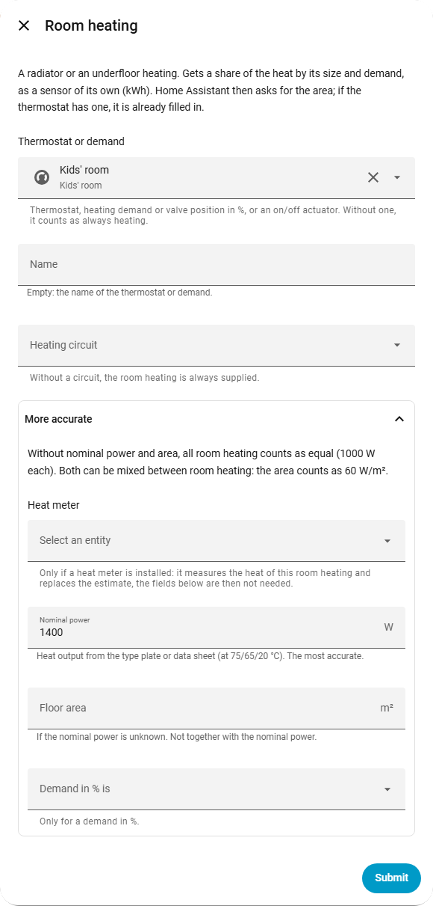{ .screenshot }

Was die Felder unter **Genauer machen** bewirken, steht unter [Genauer machen](more-accurate.md).
