# Setup

The setup asks four short questions, in the direction the heat flows: from the heat source, through the pumps, to the
rooms. Everything can be changed and added later.

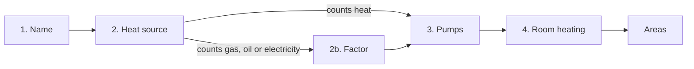

!!! tip "There is no back button"

    If something went wrong, close the dialog and start again. Nothing is saved until the last step.

## Step 1: Name

The name of your heating system, for example *Heating* or *House*. It is only a label.

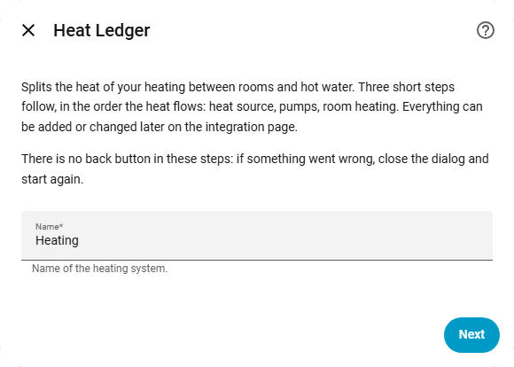{ .screenshot }

## Step 2: Heat source

Where does the heat come from? Choose the **meter** of your heating: an entity in Home Assistant that counts what the
heating uses or makes and only goes up.

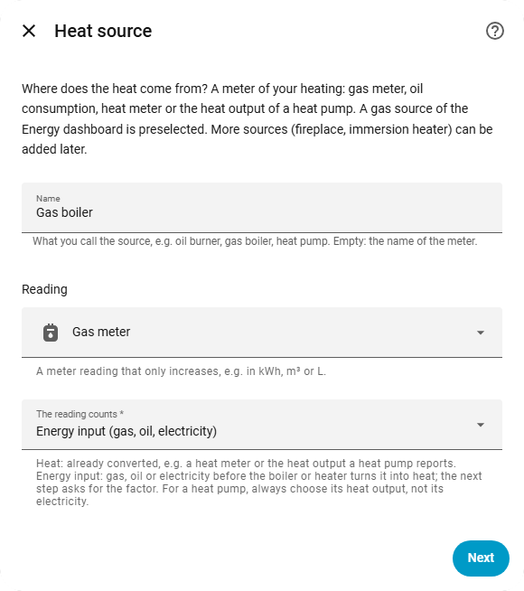{ .screenshot }

| Field | What to enter |
|---|---|
| **Name** | What you call the source, e.g. *Gas boiler*. Empty: the name of the meter. |
| **Reading** | The meter, e.g. your gas meter in m³ or kWh. If you already have a gas source in the Energy dashboard, it is preselected. |
| **The reading counts** | **Heat** or **energy input**, see below. |

**Heat or energy input?** This is the one question that needs a moment of thought:

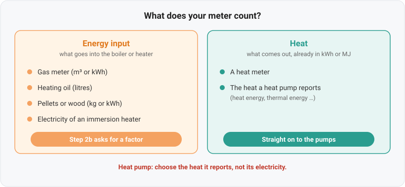{ .diagram }

!!! tip "Heat pump"

    Most heat pumps report the heat they made, often called *heat energy*, *thermal energy* or *produced heat*.
    Choose that one, as **heat**. Its electricity would be the wrong meter: a heat pump makes 3 to 4 times as much
    heat as it uses electricity, and that ratio changes with the weather.

### Step 2b: Factor (only for energy input)

How many kWh of heat does one unit of your meter give? Typical values:

| Your meter counts | Factor | Why |
|---|---|---|
| Gas in m³ | about 9 to 10 | Calorific value × z-number (both on your gas bill) × efficiency of the boiler |
| Heating oil in litres | about 9 | A litre holds about 10 kWh, the boiler turns about 90 % of it into heat |
| Gas, oil or pellets in kWh | about 0.9 | The efficiency of the boiler |
| Burner run time in hours | the output of the burner in kW | Only for a burner that always runs at the same power |
| Electricity of an immersion heater | 1 | All of it becomes heat |

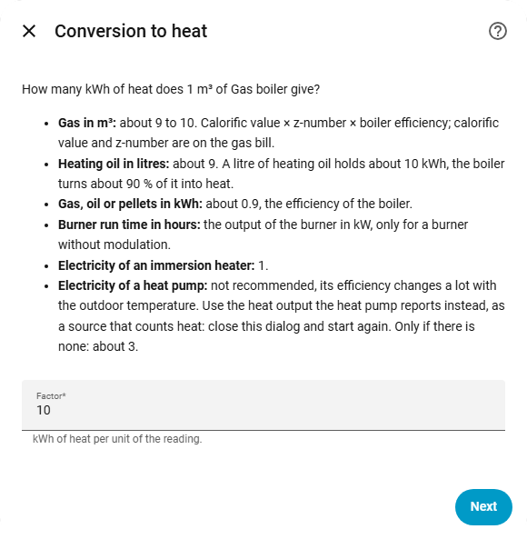{ .screenshot }

A factor that is a bit off is not a problem for the split: all rooms move up or down together, their shares stay the
same.

## Step 3: Pumps

The pumps tell Heat Ledger **when** heat flows to the rooms or into the hot water. Both fields are optional, but make
the split much more accurate.

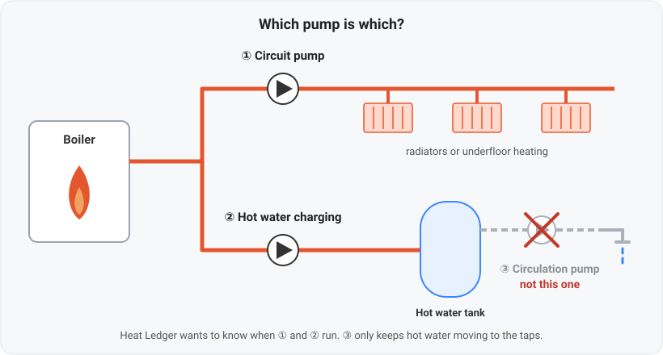{ .diagram }

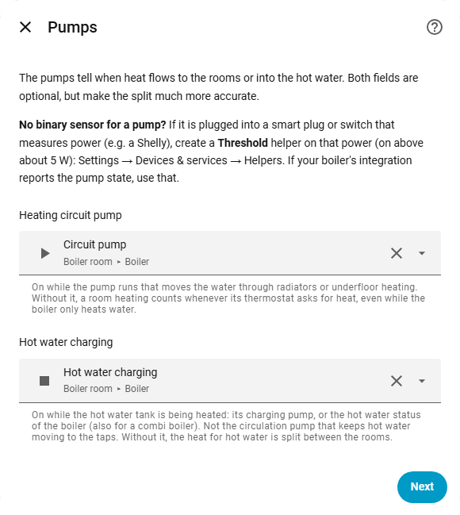{ .screenshot }

| Field | What to enter |
|---|---|
| **Circuit pump** | A binary sensor that is *on* while the pump for the radiators or the underfloor heating runs. |
| **Hot water charging** | A binary sensor that is *on* while the hot water tank is heated: its charging pump, or the hot water status of your boiler (also for a combi boiler). Not the circulation pump. |

### No binary sensor for a pump?

Many boilers report their pumps through their own integration. If yours does not, but the pump is plugged into a
smart plug or a switch that measures power (for example a Shelly), you can make one in a minute:

1. Go to **Settings → Devices & services → Helpers → Create helper → Threshold**.
2. Choose the **power** of the plug as entity and enter **5** as **upper limit** (a running pump uses more than
   5 W, a stopped one almost nothing).
3. Give it a name like *Circuit pump* and save. Use this new binary sensor in step 3.

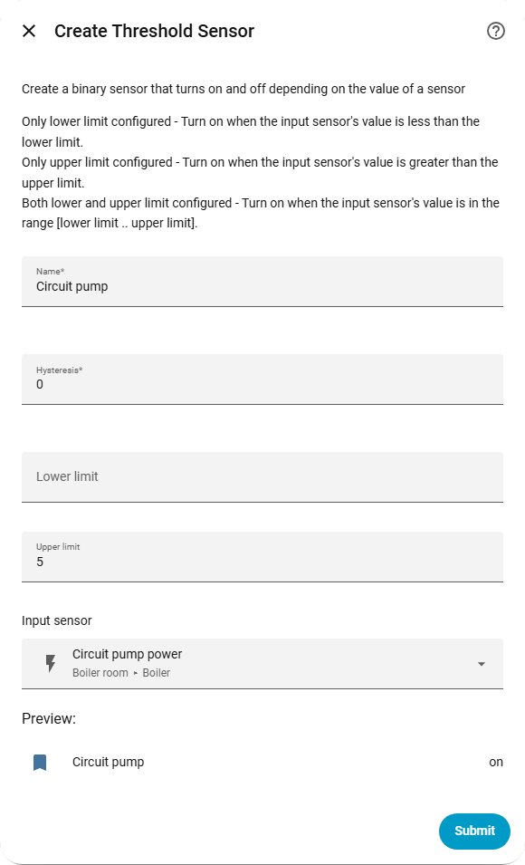{ .screenshot }

You can add the pumps later as well: **Add heating circuit** for the circuit pump, the hot water under **Add
consumer**.

## Step 4: Room heating

Choose the **thermostats** of your radiators or underfloor heating. Each one becomes a *room heating* with its own
counter.

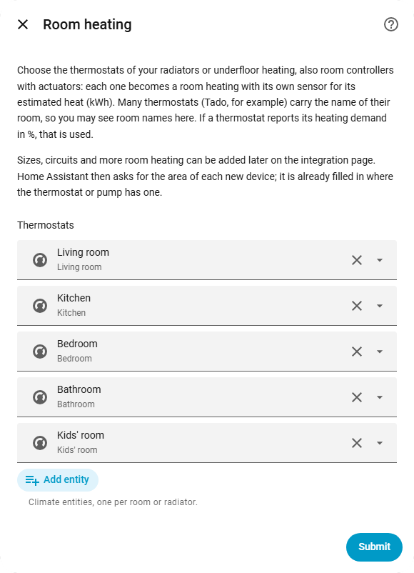{ .screenshot }

- Each room heating is named after its thermostat. Many thermostats carry the name of their room, so you see room
  names here.
- If a thermostat also reports its heating demand in % (Tado, for example), Heat Ledger uses that automatically.
- A room with two radiators and one thermostat counts as one room heating.

Click **Submit**. Home Assistant then asks for the **area** of each new device. Where the thermostat or the pump
already has one, it is filled in: just click **Finish**. The areas let the Energy dashboard group the rooms by floor.

## What you have now

Open **Settings → Devices & services → Heat Ledger**. You see your heating system with its parts:

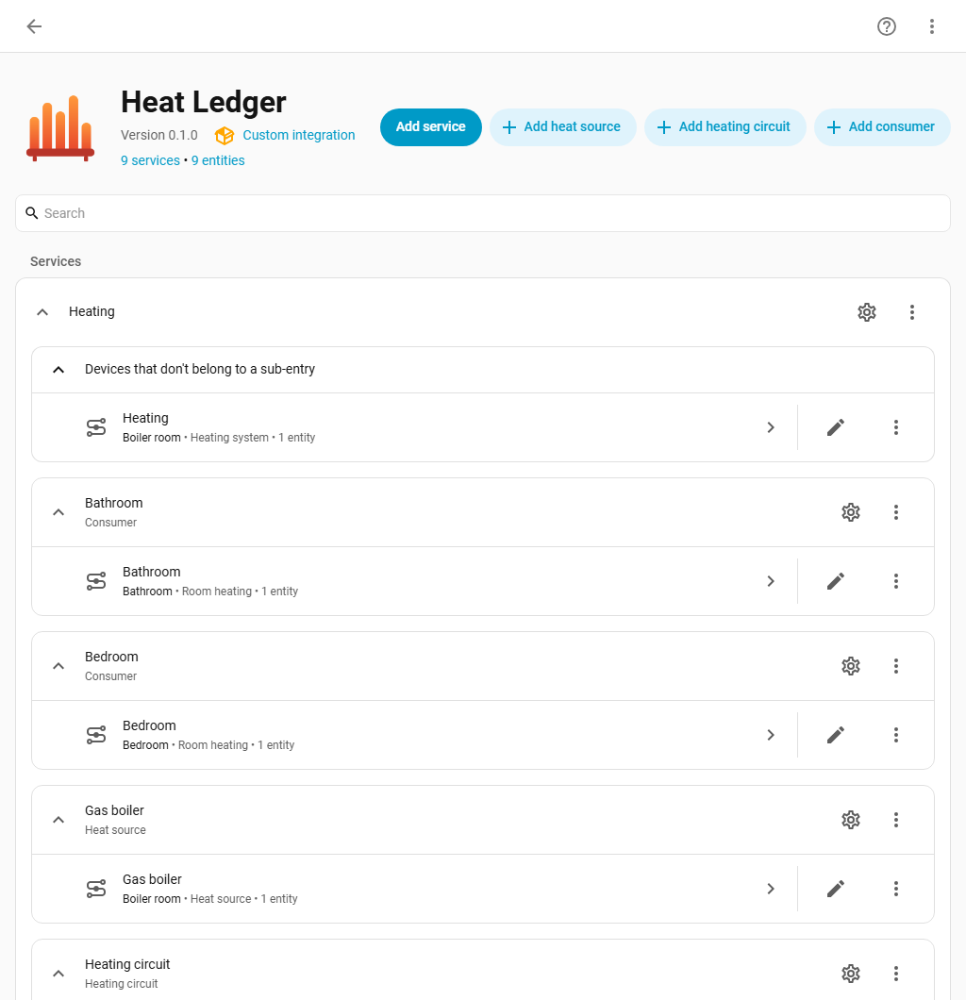{ .screenshot }

| Part | What it is |
|---|---|
| **Heating system** | The whole thing. Its sensor **Unassigned heat** shows heat that waits to be shared out. |
| **Heat source** | Your meter. If it counts energy input, it gets a sensor **Heat produced** (the reading times the factor). |
| **Heating circuit** | Only if you chose a circuit pump: the radiators behind it, with a counter for all of them together. |
| **Room heating** | One per thermostat, with the counter **Heat** in kWh. |
| **Hot water** | Only if you chose the hot water charging, with the counter **Heat** in kWh. |

The counters start at 0 and grow from now on. Continue with the [Energy dashboard](energy-dashboard.md).

## Adding and changing things later

On the integration page, the buttons at the top add more parts: **Add heat source** (a fireplace, an immersion
heater), **Add heating circuit**, and **Add consumer** (room heating or hot water). To change a part, click the gear
icon :material-cog: in its row. Its counter keeps its value.

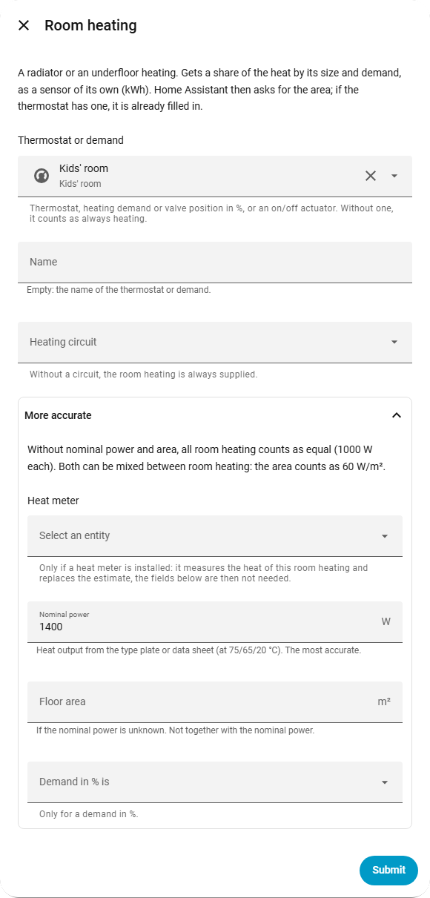{ .screenshot }

What the fields under **More accurate** do is explained on [More accurate](more-accurate.md).
